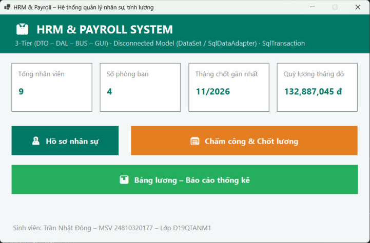
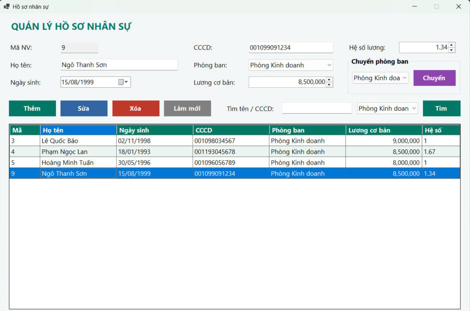
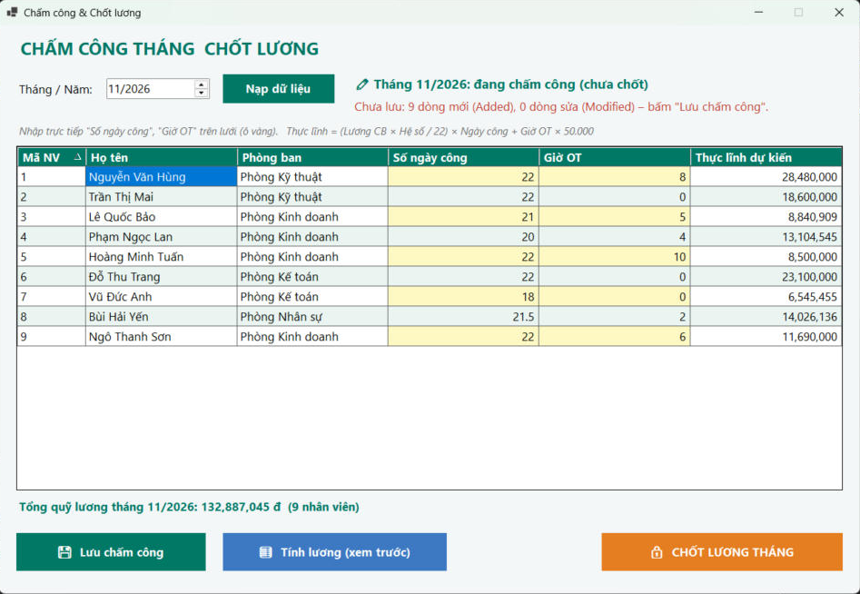
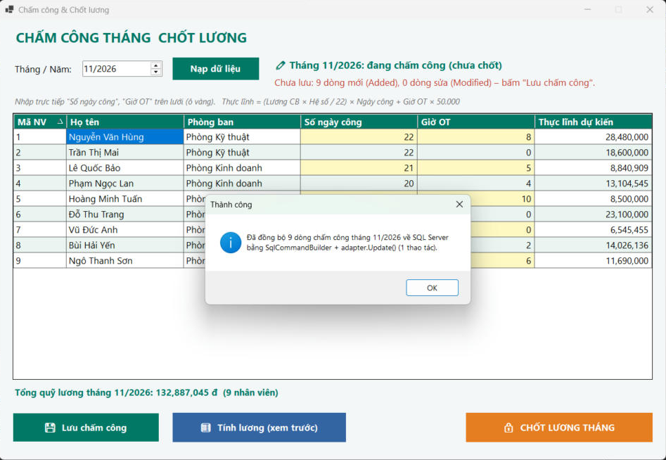
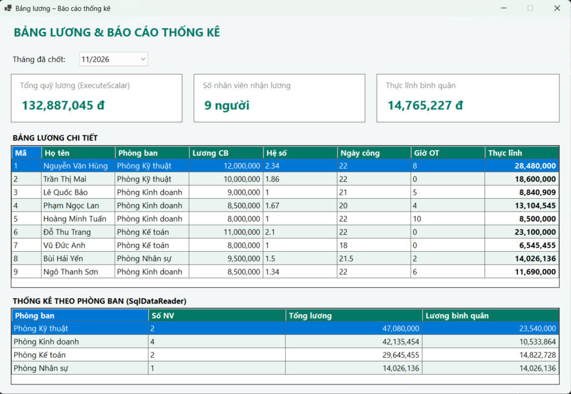
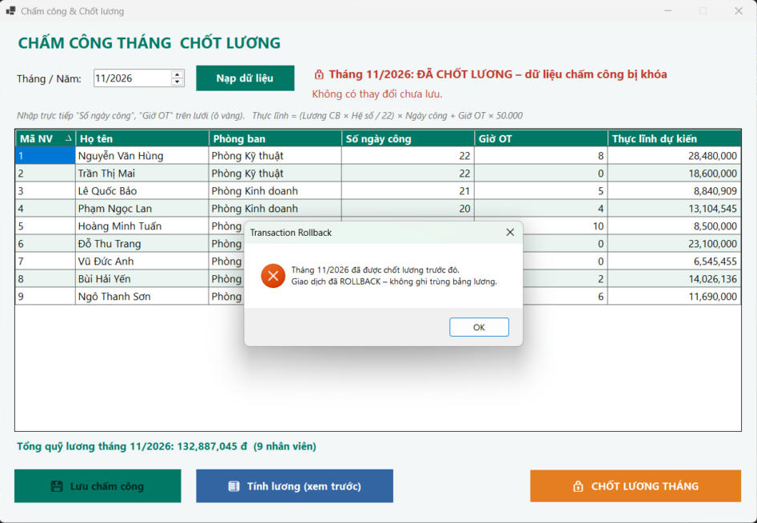

# Bài 6.2 – Hệ thống Quản lý Nhân sự & Tính lương (HRM & Payroll System)

## MỤC 1: THÔNG TIN SINH VIÊN

- **Họ và tên sinh viên:** Trần Nhật Đông
- **Mã sinh viên:** 24810320177
- **Lớp / Khóa:** D19QTANM1 – Lập trình .NET

## Công nghệ & yêu cầu đã thực hiện

| Yêu cầu đề bài | Cách làm trong project |
|---|---|
| CSDL `HRMDB` 4 bảng | `Database/ScriptDB.sql` – PhongBan, NhanVien, BangChamCong, BangLuong + dữ liệu mẫu (tháng 10/2026 đã chốt) |
| Kiến trúc 3-Tier | `DTO/` – `DAL/` – `BUS/` – `GUI/` |
| CRUD hồ sơ, chuyển phòng ban | `FrmNhanVien` (Thêm / Sửa / Xóa / nút **Chuyển** phòng ban) |
| Tìm theo tên, phòng ban hoặc CCCD (parameterized) | `NhanVienDAL.TimKiem`: `(HoTen LIKE @tk OR CCCD LIKE @tk) AND (@pb = 0 OR MaPB = @pb)` |
| Chấm công **ngắt kết nối** | `ChamCongDAL`: `SqlDataAdapter.Fill` vào `DataSet`/`DataTable`; nhân viên chưa có dòng chấm công được thêm sẵn (RowState = Added); nhập ngày công, giờ OT trực tiếp trên `DataGridView` |
| "Lưu chấm công" bằng `SqlCommandBuilder` + `adapter.Update()` | `ChamCongDAL.LuuChamCong` – đồng bộ toàn bộ dòng Added/Modified trong 1 lệnh |
| Công thức lương | `LuongBUS.TinhThucLinh`: `ThucLinh = (LuongCoBan × HeSoLuong / 22) × SoNgayCong + SoGioOT × 50.000` |
| "Chốt lương tháng" bằng `SqlTransaction` | `LuongDAL.ChotLuong`: kiểm tra chưa chốt → INSERT BangLuong cho toàn bộ nhân viên → `UPDATE BangChamCong SET DaChot = 1` (khóa chấm công) → `Commit()`; lỗi → `Rollback()` |
| Báo cáo | `FrmBangLuong`: tổng quỹ lương (`ExecuteScalar`), thống kê theo phòng ban (`SqlDataReader`) |

**Ghi chú thiết kế CSDL:**
- Đề bài ghi `MaLuong` là khóa chính Identity và đồng thời `(MaNV, ThangNam)` là khóa chính. Một bảng chỉ có 1 khóa chính nên em để `MaLuong` là PRIMARY KEY và `(MaNV, ThangNam)` là **UNIQUE**: mỗi nhân viên chỉ có 1 bảng lương mỗi tháng.
- Thêm cột `DaChot BIT` vào `BangChamCong` để "khóa dữ liệu chấm công" sau khi chốt lương. Cùng lý do, `(MaNV, ThangNam)` của BangChamCong cũng là UNIQUE.

## MỤC 2: HÌNH ẢNH KẾT QUẢ CÁC MÀN HÌNH CHỨC NĂNG

1. **Màn hình Chính / Tổng quan hệ thống**

   

2. **Màn hình Quản lý Danh mục (CRUD – Thêm/Sửa/Xóa)** – thêm nhân viên "Ngô Thanh Sơn", chuyển "Lê Quốc Bảo" sang Phòng Kinh doanh, lọc theo phòng ban.

   

3. **Màn hình Thực thi Nghiệp vụ chính (Chấm công)** – DataTable nạp bằng SqlDataAdapter, nhập ngày công/giờ OT trên lưới, tính lương xem trước.

   

   Bấm **Lưu chấm công**: SqlCommandBuilder + `adapter.Update()` đồng bộ 9 dòng trong 1 thao tác.

   

4. **Màn hình Báo cáo – Thống kê** – bảng lương tháng 11/2026 sau khi chốt, tổng quỹ lương, thống kê theo phòng ban.

   

5. **Minh họa An toàn Dữ liệu (Transaction Rollback)** – bấm "Chốt lương tháng" lần thứ hai cho tháng 11/2026 đã chốt → giao dịch ROLLBACK, không ghi trùng bảng lương; lưới chấm công đã bị khóa, nút Lưu bị vô hiệu hóa.

   

## Cấu trúc thư mục

```
├── Database/
│   └── ScriptDB.sql          # Tạo CSDL HRMDB + dữ liệu mẫu
├── QuanLyNhanSu/
│   ├── DTO/                  # PhongBanDTO, NhanVienDTO, ChamCongDTO, BangLuongDTO, ThongKePhongBanDTO
│   ├── DAL/                  # DBConnection, PhongBanDAL, NhanVienDAL, ChamCongDAL (Disconnected), LuongDAL (SqlTransaction)
│   ├── BUS/                  # NhanVienBUS, ChamCongBUS, LuongBUS
│   ├── GUI/                  # FrmMain, FrmNhanVien, FrmChamCong, FrmBangLuong, UI
│   └── App.config / Program.cs
├── images/                   # Ảnh chụp màn hình
├── README.md
└── QuanLyNhanSu.sln
```

## Cách chạy

1. Cần Visual Studio 2022/2026 với .NET 10 và **SQL Server LocalDB** (cài kèm workload ".NET desktop development").
2. Mở `QuanLyNhanSu.sln`, nhấn **F5**. NuGet tự tải `Microsoft.Data.SqlClient`.
3. Lần chạy đầu, chương trình tự chạy `Database/ScriptDB.sql` để tạo CSDL `HRMDB` (hoặc chạy script thủ công trong SSMS).
4. Dùng SQL Server Express thay vì LocalDB: sửa `Data Source` trong `App.config`.

Quy trình thử: **Chấm công & Chốt lương** → chọn tháng → nhập ngày công/giờ OT → **Lưu chấm công** → **Tính lương (xem trước)** → **Chốt lương tháng** → xem ở **Bảng lương – Báo cáo**.
